## 1、编译说明
1. 编译完成以后记得将源码下的file目录下（切记是file目录下而不是file目录）的所有文件复制到可执行文件同一目录下即可。
2. 可执行文件在源码同级目录下的bin目录，和core_mapwidget目录同级，这个目录在编译后自动生成。
3. 本组件支持各种地图源，内置了不同厂家对应下载瓦片的秘钥，建议换成自己的秘钥。
4. 在开启了缓存的时候，首次加载本地缓存文件会比较慢，再次加载会非常快，这是因为系统层缓存了文件，再次访问该文件的时候会非常快，这个属于正常现象。linux系统不存在这个问题，响应非常迅速。
5. 开启缓存后，在线下载的瓦片图片文件会自动保存在对应目录下，下次就算断网，也优先从缓存目录加载，相当于离线地图。这个机制和奥维地图等软件的机制一样。但是有个缺点，就是必须先显示过了对应级别对应区域的地图，才会下载，按需下载。有个缺点就是占用存储空间，同一个区域的瓦片文件会自动覆盖。
6. 有时候我们希望是先用离线地图下载器下载好了的文件，直接打包放到目录使用，也就是本软件一开始就是在断网的环境使用。此时本软件需要选择离线地图，从对应目录加载。默认从可执行文件所在目录下加载，比如maptian/tiles_cva_w，mapgaode/tiles，也可以通过代码设置离线地图目录，不指定就按照默认规则来。
7. 瓦片文件格式是 z/x/y.jpg 和 z/x/y.png 这种。如果自己用离线地图下载器下载的时候，记得是按照这个格式保存的瓦片。
8. 本软件的离线地图下载模块和海拔高程模块都是作为补充存在的，并不是地图组件的核心。离线地图下载模块下载好的瓦片地图文件，除了可以给本软件使用外，可以提供给其他需要离线地图的软件使用，全部通用，按照标准格式下载。
9. 天地图每个秘钥每天的下载数量有限制。个人开发者限制在1W张，企业开发者限制在30W张，可以切换到账号后台 https://console.tianditu.gov.cn/api/traffic 查看具体限制。建议多申请几个秘钥，在MapDownHelper::initUrl()函数中加入多个秘钥，下载的时候会自动切换秘钥下载，这样可以下载的张数多一些。还有就是下载的时候尽量分区域下载，不然你都不知道下载到哪里失败了，以便下次继续下载。

## 2、使用说明
### 2.1 代码使用
1. 将core_mapwidget目录拷贝到你的项目目录，并在pro中填写引入代码加入到你的项目中。$$PWD/../表示上级目录。
```cpp
include ($$PWD/../core_mapwidget/core_mapwidget.pri)
```
2. 引入头文件，编写代码。
```cpp
#include "mapwidget.h"

//创建地图控件
MapWidget w;
//设置瓦片源头
w.setTileSource(TileSource_Tian);
//设置瓦片类型
w.setTileType(TileType_Satellite);
//设置离线地图
//w.setOffline(true);
//设置瓦片目录
//w.setOfflinePath("./maptian");
//加载地图
w.load();
```
3. 更详细的接口参考mapwidget.h头文件。

### 2.2 通用配置
在每个tab页面的右上角，可以选择不同地图源、地图的类型、在线离线、是否开启缓存等参数，这些都是完全一样的内容，作为通用的配置参数，在这里做下说明。

1. 地图内核，选择不同厂家的地图源。
2. 地图类型，可以选择街道图、卫星图、混合图几种。
3. 地图模式，是在线地图还是离线地图，如果是在线地图，必须联网获取瓦片数据，离线地图自动从本地获取瓦片数据。
4. 开启缓存，这个只对在线地图模式有用，也就是下载好的瓦片地图文件，是否需要同步存储到本地，这样下次直接优先从本地加载。


### 2.3 基础示例
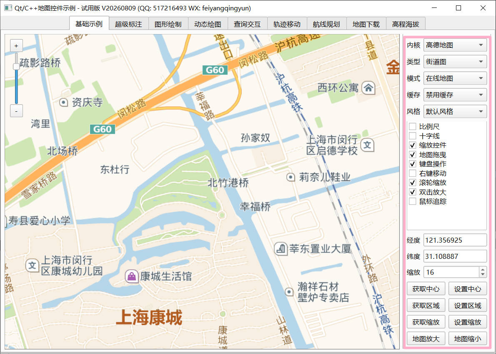

1. 本示例演示地图组件的一些基础用法。
2. 在功能列表框中，单击选中再次单击取消选中对应功能。
- 比例尺，地图左下角显示比例尺图样，在不同缩放下会显示不同的比例尺。
- 十字线，地图中心位置显示一个十字线，方便标识哪里是地图中心。
- 缩放控件，一个由放大缩小两个按钮和一个滑动条组成的控件，单击按钮可以放大或者缩小地图，拉动滑块到对应缩放级别会自动切换到对应缩放级别的地图。这个缩放控件可以摆放到左上角、右上角、左下角、右下角四个位置。这里每次勾选的时候都会设置到一个位置，可以切换复选框看到对应效果。
- 地图拖曳，开启后可以鼠标按住地图拖动，有些场景比如绘制图形的时候，可以禁用此功能，以便按下的时候开始绘图。
- 键盘操作，开启后可以和实体键盘的上下左右按键同步处理，比如按下键盘左箭头，则地图往右边移动，不断看到左侧地图区域。也支持+-按键放大和缩小地图。
- 右键移动，默认不支持右键按住地图拖曳，开启后可以，在某些场景下，可能左键按下做特殊处理，希望右键来拖曳移动地图。
- 滚轮缩放，开启后可以通过鼠标滚轮实现地图缩放。
- 双击放大，开启后双击地图自动放大。
- 鼠标追踪，开启后，不需要按住鼠标，自动识别鼠标移动，并发出对应移动处的经纬度坐标。

3. 切换风格样式下拉框，会自动应用对应的样式，要存在透明叠加图层的时候才有效果，比如天地图的街道图和混合图。
3. 单击获取中心，将当前地图的中心点坐标显示到经纬度文本框中。
3. 单击设置中心，将经纬度文本框中的数据作为中心点坐标设置到地图，可以在左侧地图控件上鼠标按下，自动填入对应的经纬度坐标。
3. 单击获取区域，获取当前地图控件显示区域的范围，弹框显示结果。
3. 单击设置区域，代码中写死的设置中国的完整区域，演示如何传入一个qrectf值设置显示对应的区域。
3. 单击获取缩放，将当前地图的缩放级别显示在微调框中。
3. 单击设置缩放，将微调框中的缩放值，设置到地图中。
3. 单击地图放大，和缩放控件的 + 按钮执行的动作一样，放大地图。
3. 单击地图缩小，和缩放控件的 - 按钮执行的动作一样，缩小地图。

### 2.4 超级标注
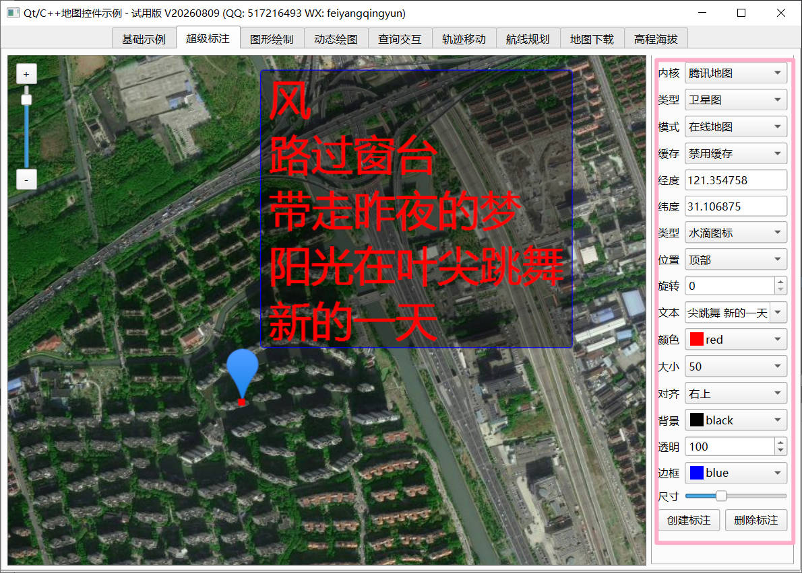

1. 本示例演示标注点这个图形的一些参数设置，这些参数的更新都是立即应用，所见即所得。
2. 单击生成标注按钮，以右侧设置好的标注点的参数，生成一个标注点在地图上。
3. 单击删除标注按钮，自动清空地图上的标注点。
4. 在地图上单击，会自动显示经纬度值到对应文本框中。如果已经存在标注点，同时会移动标注点到对应的新的位置，也就是鼠标按下处的位置。
5. 图标类型，可以选择水滴图标，飞机图标，动态图标，就是更新标注点的图片，支持gif动图。
6. 图标位置，可以选择左边、右边、中间、左上、右上、顶部、左下、右下、底部共9个位置，表示标注点在设置的经纬度坐标的哪个位置，一般水滴图标会选择显示在坐标的顶部，飞机图标显示在中间。
7. 旋转角度，标注点根据这个角度旋转显示，支持动图旋转，一般飞行的时候需要调整角度进行显示，组件中内置了函数计算两个经纬度坐标的角度值。
8. 文本内容，每个标注点都可以显示自己附带的一些文本内容，支持换行多行文本，下拉框可以选择不同的文本样式，比如有垂直文字，就是通过换行实现的。
9. 文本颜色，对应文本文字的颜色，从颜色下拉框中选择。
10. 文字大小，对应文本文字的字体大小，也就是字号，值越大文字越大。
11. 文字对齐，这个文字相对于图标的位置，和图标位置一样，都有9种位置可以选择，默认建议显示在右上角。
12. 文字背景，文字区域的背景颜色，如果没有背景颜色，这个文字很容易和地图的颜色混在一起不好看，一般建议设置文本背景颜色用于区分。
13. 背景透明，背景颜色透明度值，纯色会遮住了下面的地图图片，一般会设置半透明效果，这样既可以看到文字信息，又能看到背后的地图。
14. 边框颜色，文字背景对应的边框的颜色，还可以设置边框的粗细，代码中支持，这里没有放出选择。
15. 边框粗细，参数支持的，目前没有放到界面上，函数接口里面都有。
16. 图标尺寸，拉动滑动条，可以动态调整图标尺寸大小，演示如何更新已经设置好的标注点图标。
17. **addMarker函数支持传入标注图片的路径，也支持直接传入qpixmap对象，如果是gif图片，需要传入路径，会根据路径判断是否是gif，默认按照原图的大小显示，如果需要缩放调整大小，你需要通过传入qpixmap对象的方式来设置，比如 QPixmap pix("1.png"); pix = pix.scaled(QSize(100, 100), Qt::KeepAspectRatio); addMarker函数第三个参数是传入qpixmap对象。如果两个都传了，二选一路径优先，路径可以填空值比如QString()。**

### 2.5 图形绘制
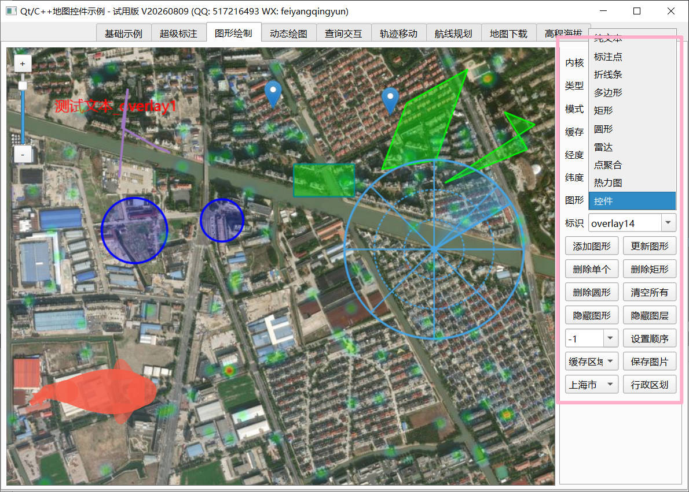
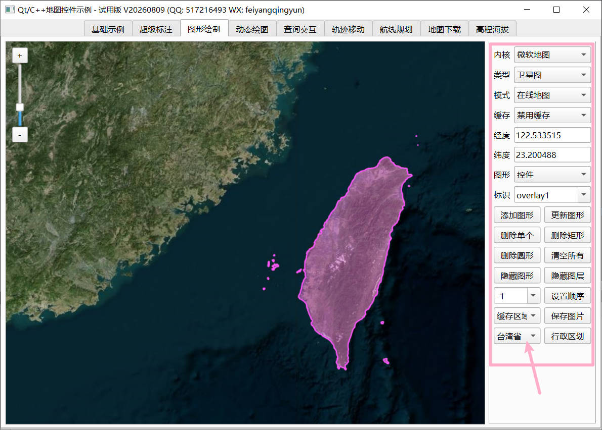

1. 本示例演示各种图形绘制，也就是覆盖物。
2. 每一种图形可以添加和更新，单击添加按钮添加对应的图形，每个图形都有唯一的标识，理论上这个标识要求唯一，实际上不唯一也是可以的，代码层做了兼容，如果不唯一的话，在更新或者删除指定标识图形的时候，可能会对所有符合条件的进行处理。
3. 先地图上鼠标按下选坐标，然后图形下拉框选择需要添加的图形。
4. 单击添加按钮，在对应经纬度坐标为基准的地方添加对应的图形。
5. 单击更新按钮，需要先从标识下拉框选择要更新图形的唯一标识，选择后再单击。
6. 删除单个，隐藏图形、设置顺序这三个功能，也都是需要先选择图形标识。
7. 删除矩形，删除圆形，有时候需要统一删除一种类型的图形，比如删除所有圆形，其他保留。
8. 隐藏图层，相当于隐藏所有图形，其实是对整个图形图层进行了隐藏，也就根本不会执行该图层上的图形的绘制。
9. 设置顺序，默认图形的叠加绘制顺序按照添加的顺序来，越早绘制的越在底部显示，有时候需要将某个图形单独移到最前面显示。可以设置每个图形的叠加顺序索引，值越大越显示到前面。
10. 保存图片，这里演示瓦片拼接功能，从下拉框选择对应要保存的图片，单击保存，图片保存在mapsnap目录下。
- 可视区域，将当前地图组件可见部分截取出来保存。
- 缓存区域，将整个缓存区域的地图图片保存，默认是可视区域的2倍大小。
- 裁剪区域，如果选择了行政区划，则以行政区划的轮廓作为裁剪区域，裁剪后的图片保存。
- 北京市区，演示直接指定某个区域范围进行裁剪，这个矩形的方式，就是相当于指定一个经纬度范围，做瓦片拼接并保存到一张图片上。
10. 行政区划，一些省市区县的轮廓图，自动从mapboundary目录加载。切换下拉框自动显示对应的轮廓图。

### 2.6 动态绘图
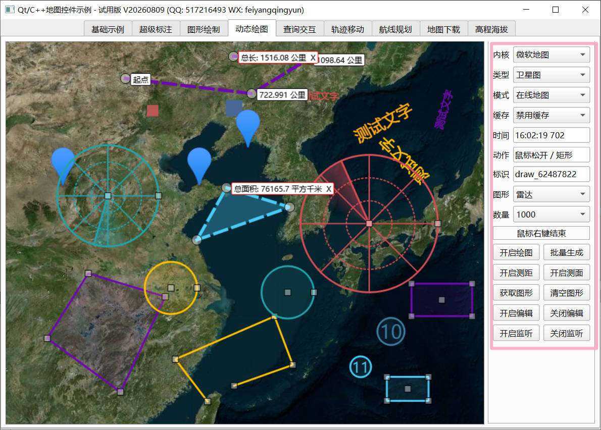
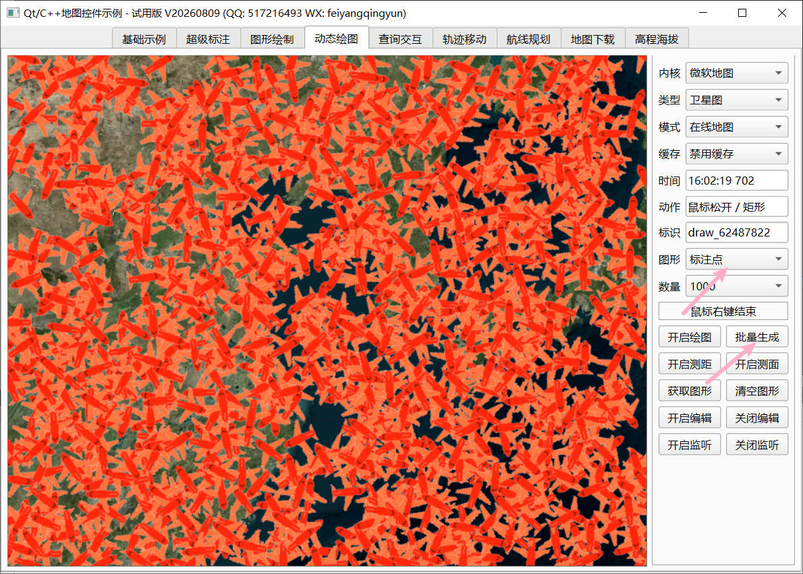

1. 本示例演示动态绘图，在地图上按下进行各种图形的绘制，支持坐标点、文本、标注点、折线、多边形、矩形、圆形、雷达等。
2. **如何结束绘制：选中取消单选框，或者鼠标右键。**
3. 获取图形，获取地图上图形的具体信息，比如标注点的经纬度坐标，矩形的左上角右下角坐标等。
4. 清空图形，清空地图上的所有图形。
5. 开启编辑，对地图上所有图形开启编辑功能，坐标点、文本、标注点可以拖动调整位置，折线、多边形可以调整每个点的位置，也支持整体拖曳，矩形可以调整四个角拉伸变大变小，圆形和雷达可以拉动边缘点调整半径。只要鼠标在对应图形区域内，除了边缘点，其他都是可以整体拖曳。
6. 关闭编辑，开启编辑后会在相关的坐标点显示一个小矩形，比如折线多边形的每个点，矩形的四个角，圆形的中心点和边缘点。关闭编辑后，不显示这些小矩形，同时禁止拖曳和调整位置。
7. 开启监听，默认地图不对图层中的图形监听对应的事件，比如鼠标按下松开移动等，只有开启后才会响应，有时候二开需要开启拿到对应事件后进行相应的处理。
8. 关闭监听，关闭后不再监听图形的各种事件。
9. 单个处理，函数接口支持对单个图形开启和关闭编辑以及监听，这里不做演示。
10. 批量生成，先从单选框选择要批量生成的图形。然后从数量下拉框选择要批量生成的数量，一键批量生成对应的图形。可以用这个来测试地图组件的性能，比如生成10000个标注点用时多久，占用CPU和内存多少。这块相比于web的地图，性能百倍提升。

### 2.7 查询交互
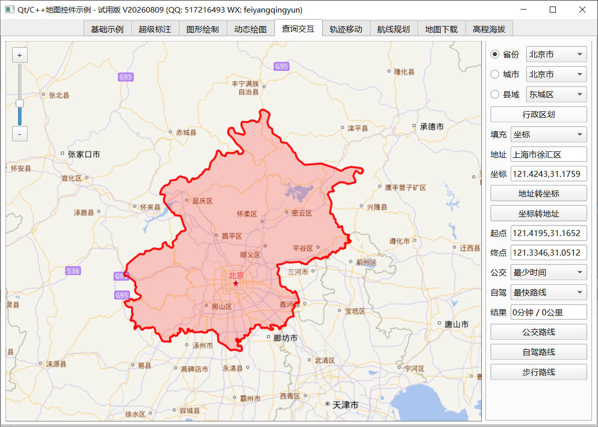
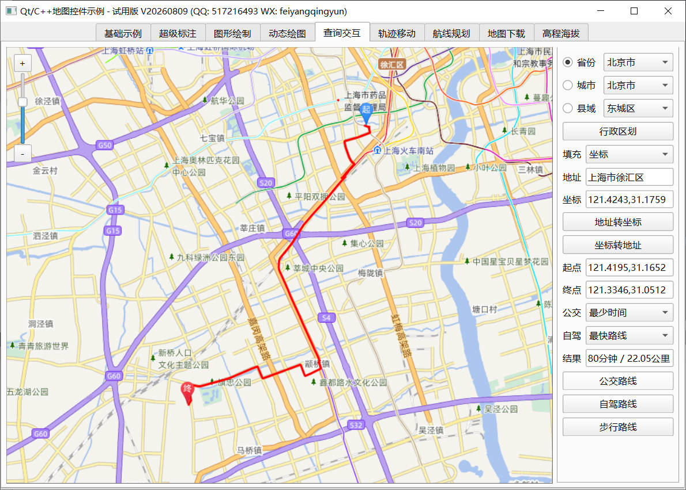

1. 本组件采用纯QWidget的painter绘制，都是离线本地的，还缺少路径查询等功能，这个需要联网查询，本组件默认与天地图的服务器交互查询。
2. 右上角用来查询行政区划，可以勾选省份、城市、县域三种，勾选了哪一种，最终查询的结果就是哪一种，比如单选的省份江西省，尽管下面还是城市和县域的下拉框都选了，单击行政区划按钮，只会联网查询省份的轮廓信息。每次查询后对应的轮廓信息会保存到mapboundary目录。
3. 地址栏输入详细地址，单击地址转坐标按钮，会将这个地址最近的经纬度坐标填在坐标文本框中。
4. 坐标栏输入详细经纬度坐标，单击坐标转地址按钮，会将这个经纬度坐标最近的地址填在地址文本框中。
5. 右下角是路线规划查询，可以选择不同的公交策略或者自驾策略，查询结果有对应的轨迹点集合，用时时长、总路程。

### 2.8 轨迹移动
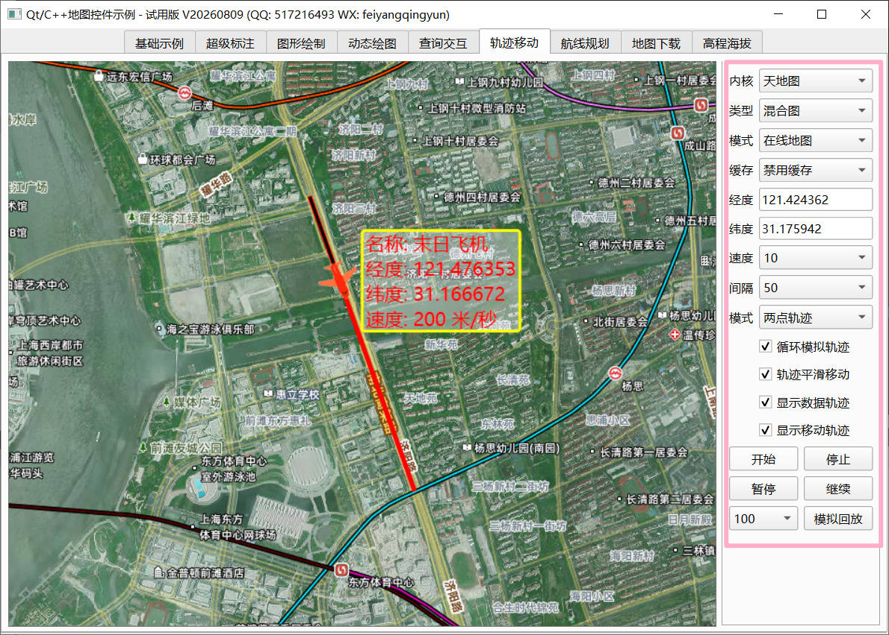
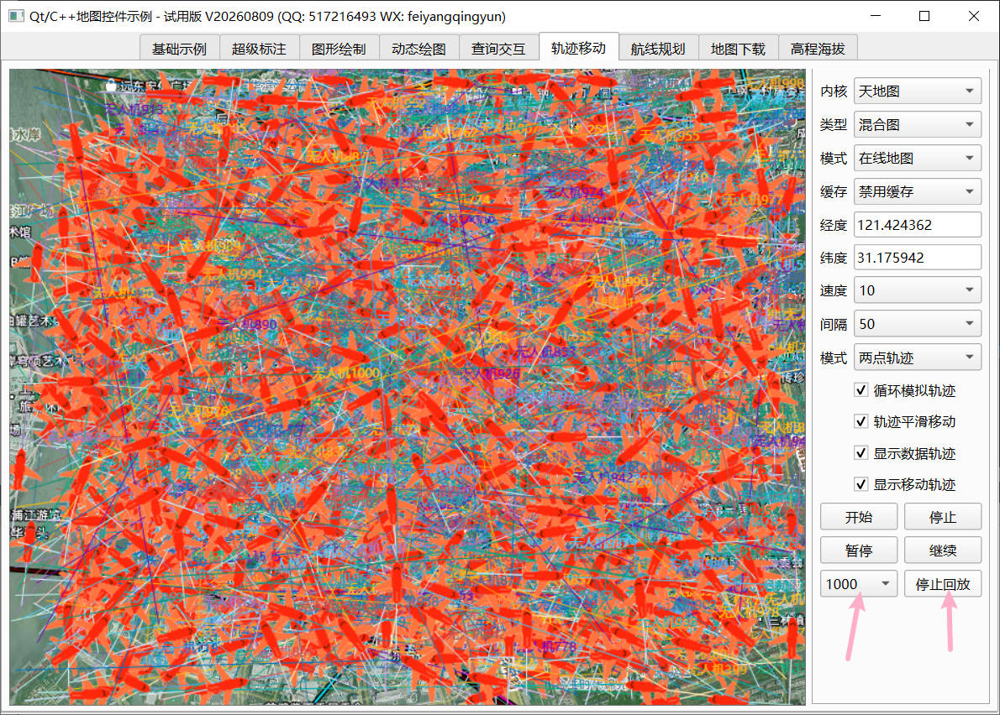

1. 本示例演示实时轨迹和轨迹回放以及批量轨迹显示等功能。
2. 移动速度，每次移动的距离，单位米。
3. 移动间隔，多久触发一次移动，单位毫秒。
4. 轨迹模式，选择实时轨迹后，可以在地图上鼠标右键按下点，自动添加对应的点到轨迹点集合中，飞机会自动按照你设定的轨迹飞行。选择两点轨迹，演示给定两个经纬度坐标，自动生成平滑坐标点移动，用来对比跳跃移动。其他两个轨迹回放1和2是直接从轨迹点集合文件中读取对应的数据进行轨迹回放。
5. 循环模拟轨迹，不勾选的话，只模拟一次，走完就停止。
6. 轨迹平滑移动，默认勾选，会自动生成平滑坐标点移动。
7. 显示数据轨迹，是否显示历史数据的轨迹，可以动态勾选看效果。
8. 显示移动轨迹，是否显示正在移动的轨迹，可以动态勾选看效果。
9. 可以单击按钮执行开始移动、停止移动、暂停移动、继续移动。
10. 单击模拟多条轨迹回放，自动生成N条不同颜色的轨迹，自动回放。

### 2.9 航线规划
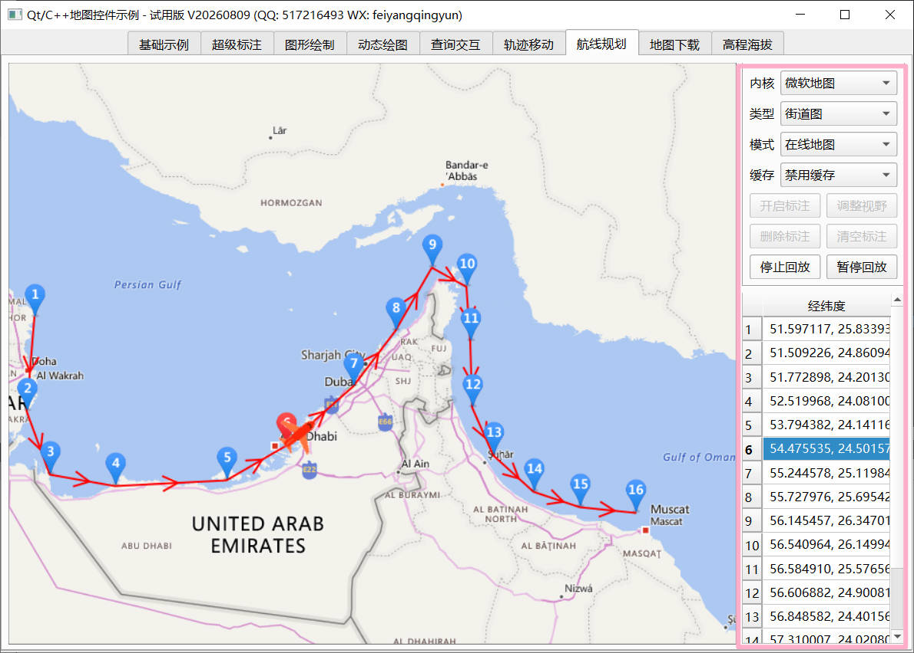

1. 本示例演示如何在地图上动态选点添加航迹线路，核心就是markerline类的使用。默认从 data/points_marker.txt文件读取经纬度坐标，有更新变动也会自动保存到该文件。可以做成多个航迹规划文件，每个从自己的文件中读取。
2. 开启标注，开启标注后，可以在地图上单击增加点，也可以按住标注点拖动移动位置，标注点都有序号显示，按下标注点后会突出颜色显示，也就是更新了对应标注点图片。在添加和拖动后，会自动更新最新的经纬度信息到表格中。
3. 调整视野，单击后，自动调整地图到合理的区域范围以及缩放级别，保证满屏显示完所有标注点。
4. 删除标注，在地图上按下选中标注点，或者从表格中选中点，单击删除标注，将该坐标从集合中删除。
5. 清空标注，将所有标注点全部删除。
6. 开始回放，单击开始回放，会自动生成一个飞机模拟飞行，按照设置的轨迹，验证是否正确。
7. 暂停回放，在回放过程中，可以单击暂停回放，继续回放。

### 2.10 地图下载
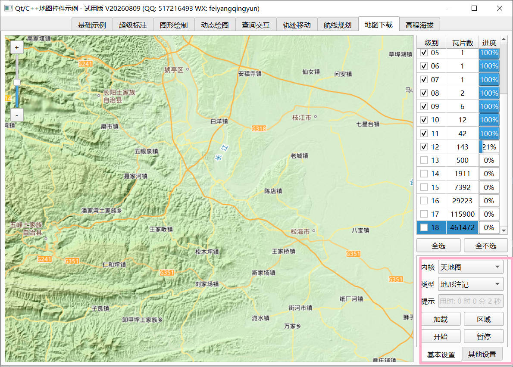

1. 第一步，选择地图厂家，比如天地图。
2. 第二步，选择地图类型，比如街道图、卫星图等，天地图的话有6种类型。
3. 第三步，调整左侧地图区域，最终会按照这个显示的区域进行下载。
4. 第四步，单击加载按钮，会自动计算左侧显示区域的不同缩放级别的瓦片数量。
5. 第五步，勾选要下载的层级，层级越大越详细，一般建议下载到15级别就够。
6. 第六步，单击开始按钮，自动多线程下载，可以暂停下载。
7. 区域按钮用来左侧绘制矩形框选要下载的区域，框选完成以后自动计算瓦片数量。
8. 其他设置中有当前地图缩放级别和保存瓦片的目录设置等。
9. 天地图每个秘钥每天的下载数量有限制。个人开发者限制在1W张，企业开发者限制在30W张，可以切换到账号后台 https://console.tianditu.gov.cn/api/traffic 查看具体限制。建议多申请几个秘钥，在MapDownHelper::initUrl()函数中加入多个秘钥，下载的时候会自动切换秘钥下载，这样可以下载的张数多一些。还有就是下载的时候尽量分区域下载，不然你都不知道下载到哪里失败了，以便下次继续下载。
10. 谷歌瓦片地图下载有可能需要翻墙才能使用。
11. 如果加载下载好的离线地图没有看到，只有一种可能，那就是当前级别当前范围的离线地图没有下载，你需要鼠标滚轮缩放和拖动到你下载的区域和级别才能看到，那问题来了，都没有图片也不知道拖到哪里了，所有就需要下载离线地图的时候，先下载大致的全国地图的轮廓，也不多，比如全国的下载到12级别，这样就可以拖动到对应的省份市区等。

### 2.11 高程海拔
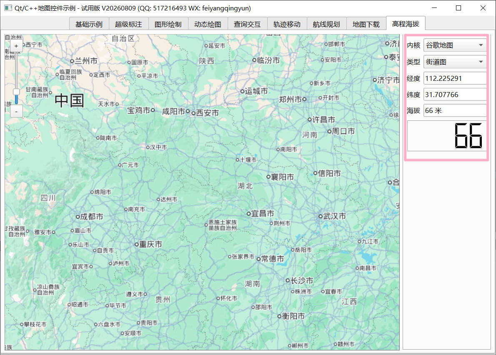

1. 本示例演示实时海拔高程数据。
2. 本地离线读取，传入的经纬度获取海拔高度值。
3. 地图比例尺1000米，可以去官网下载更详细的区域地图高程数据，比例尺精度更高。

## 3、功能特点
1. 支持各种地图源，包括天地图、高德地图、腾讯地图、谷歌地图、微软地图、ArcGis、OpenStreet、360地图等。
2. 同时支持WGS-84地球坐标系和GCJ-02火星坐标系，如果是天地图、谷歌地图，自动应用WGS-84坐标系，如果是高德地图、腾讯地图，自动应用GCJ-02坐标系。也可以主动设置在WGS-84坐标系加载高德地图，内部会自动处理坐标偏移。
3. 同时支持默卡托投影和经纬度投影，比如天地图的地图源可以是默卡托投影或者经纬度投影。
4. 每一种地图源都支持在线和离线两种场景需求，可以自定义在线瓦片地址格式和离线瓦片地址格式。
5. 多线程下载和加载瓦片图片文件，多线程绘制，自动缓存瓦片文件。
6. 在线模式下，可以开启是否缓存文件，指定缓存路径，将下载的瓦片文件存放到本地，默认优先从缓存文件查找，如果存在缓存文件则加载缓存文件，不存在则联网下载。
7. 可以任意拖曳地图，鼠标滚轮放大和缩小地图，以鼠标所在位置作为缩放中心点，提供缩放控件手动单击进行操作，支持鼠标左键双击放大和右键双击缩小。
8. 多图层机制，支持多个瓦片叠加图层和图形绘制图层，全部采用双缓冲技术，所有的图形和瓦片全部绘制到一个图片文件上，最终再将图片文件绘制到地图控件。不可见区域的图层包括覆盖物不会触发绘制，最大程度降低CPU占用。
9. 动态图层机制，瓦片图层和图形图层分离，图形图层不更新的情况下，动态更新底图瓦片图层，任意切换更新多个瓦片图层。无需重新加载整个地图。
10. 预加载机制，默认绘制的图层大小以当前区域往四周放大一倍，这样在鼠标拖动和缩放的时候，不会看到明显的加载过程，因为已经提前预加载好了，体验友好。
11. 内置了多种图形覆盖物，包括坐标点、纯文本、标注点、折线条、多边形、矩形、圆形、雷达、点聚合、热力图等，可以设置边框颜色粗细、填充颜色和透明度等众多参数。
12. 标注点支持旋转角度和提示文本，其中提示文本可以设置在标注点的相对位置，标注点图片支持gif动图，可以动态切换静态图和动图。
13. 标注点和提示文本可以设置相对位置，位置包括左侧、右侧、上侧、下侧、中间、左上角、右上角、左下角、右下角。标注点默认按照底部居中对齐，一般圆形图标可以设置中心点对齐。
14. 标注点提示文本可设置背景颜色，透明度、颜色边框和粗细，支持换行和多行文字。
15. 所有的图形可以动态更新前景色、颜色粗细、背景颜色、颜色透明度等。
16. 支持删除单个图形、删除一种类型的图形、删除所有图形、隐藏单个或者所有图形等。
17. 支持动态绘制各种图形，开启后直接在地图上鼠标按下绘制，鼠标右键结束绘制，非常方便快捷。
18. 在对应图形区域鼠标按下，发出图形单击信号，精准识别单击区域，比如折线以鼠标在折线条上作为判断依据，多边形区域以鼠标在整个多边形区域内为准，而不是以矩形区域，包括圆形也是以圆形内部为准。
19. 可以动态启动禁用比例尺、十字线、缩放控件、地图拖曳、键盘操作、滚轮缩放、双击缩放、鼠标追踪等特性。
20. 可以任意指定经纬度区域进行瓦片拼接保存成图片文件，也可以直接对整个可视区域或者缓存区域的地图图片文件保存。支持任意多边形轮廓保存成图片，比如某个行政区的瓦片保存。
21. 图形可以动态设置zindex层叠顺序，值越大，越显示在前面，内部维护着一个zindex表，默认按照添加的先后顺序增加，后面添加的显示在前面，主动设置后，按照设置的zindex来绘制。
22. 支持将QWidget对象作为覆盖物添加到地图控件中，跟随地图移动位置，极大提高灵活性，比如可以将自定义控件直接作为地图控件的子对象加入进去。
23. 支持测距和测面积，动态绘制多边形区域，实时动态调整位置和点坐标自动重新计算，可以关闭单个测距测面的图形。
24. 内置MarkerMove轨迹移动类，支持历史轨迹数据回放和实时轨迹移动，可设置图标、轨迹线的颜色和粗细、移动速度、移动间隔、平滑移动等，支持多条轨迹线条同时移动。
25. 内置MarkerLine航迹规划类，支持动态添加航迹点，显示对应箭头，可以动态拖曳调整航迹点的位置，选中点高亮显示。
26. 大量使用按需绘制机制，包括内部提供合理的默认值来触发绘制，也可以手动传入参数指定是否需要立即绘制，比如删除了某个覆盖物，有些频繁的操作可以不指定立即绘制，等操作完成后再统一一起绘制，效率更高。
27. 默认开启内存瓦片机制，所有加载过的瓦片文件都存储在内存中，下次再次绘制直接从内存取出来绘制，既不需要从联网获取，也不需要从缓存文件获取，直接内存取出来绘制，响应迅速效率最高体验最佳。
28. 支持批量添加覆盖物，比如几万个标注点和圆形，都是瞬间完成绘制，相比web网页的方式，性能提升百倍以上。
29. 支持街道图、卫星图、混合图、路网图等各种图层，可以任意叠加N个图层，甚至杂交不同地图厂家的瓦片文件。
30. 内置缩放动画效果，在缩放的时候先截取上一个地图画面作为缩放动画基准图片，逐步过渡到下一个层级。
31. 内置电子放大机制，瓦片图片不存在的时候，优先获取该区域上一图层的瓦片，按照规则裁切图片缩放填充，最大支持两级图层放大，在线和离线模式都支持电子放大。在线情况下主动获取上一级的瓦片，离线情况下主动本地文件查找。
32. 纯QWidget绘制，非qml也非web，不依赖qml或者浏览器控件，支持极低性能的嵌入式环境。
33. 原创轻量级，核心代码5000行，整体代码10000行，架构漂亮，注释详细，拓展方便，容易学习，适合各种初学者和进阶者，方便二次开发。
34. 支持任意Qt版本、任意系统、任意编译器，包括嵌入式linux和各种国产电脑环境。
35. 全部原创自研，古法编程，不含任何AI代码，持续迭代更新，商业级别、品质保证。

## 4、其他说明
### 4.1 加载流程
1. 第一步，先从内存缓存的pixmap队列中查找对应url地址对应的图片缓存，存在则取出来显示，速度最快。
2. 第二步，内存缓存没有，则判断是否开启了缓存目录，开启了，则从缓存目录找对应url地址存储的文件，找到了则加载对应文件缓存显示，速度一般，但是比从网络地址下载要快很多。
3. 第三步，内存缓存和文件缓存都没有，则直接从网络下载，下载后再显示，速度最慢，但是首次加载一般都需要这个步骤。
4. 第四步，如果是离线地图，则直接取设置的离线路径的瓦片文件，不经过内存缓存。

### 4.2 占位符说明
1. 主机编号占位符 {n}，通过MapAdapter的setIds函数设置编号字符串，然后随机取。
2. 主机编号范围占位符 {n-0-5-n} {n-1-3-n} {n-a-c-n}，直接地址中就带入编号范围，程序会自动解析出来编号字符串。
3. 反转TMS坐标系占位符 {-y}。
4. 微软地图占位符 {x}{y}{z}。
5. 腾讯地图占位符 {x/16}。
6. 坐标占位符 {x} {y} {z}，替换对应瓦片的xyz的值。


## 5、版本说明

**V202608**
1. 修复圆形图形在高纬度地图半径计算偏差太大的问题，对距离转度数函数getDegreesFromMeters增加纬度参数，这样计算才准确，之前是固定赤道纬度。
2. 修复圆形按下拖动位置的判断不准的BUG，之前按照二维圆形判断按下的坐标离圆心的距离小于半径，要改成三维球面来计算。
3. 增加gcj02转wgs84坐标转换，加载高德地图和腾讯地图，之前有偏移，现在地图控件内部做了转换。
4. 新增雷达扫描、点聚合、热力图等图形。
5. 对地图控件核心组件，增加动画缩放机制，之前是快速的切换，很生硬，现在会将背景图平滑缩放过渡，有个过渡效果，和其他地图软件一样，看起来非常丝滑。
6. 双击缩放改成以双击处的坐标为中心缩放，之前是以可视化区域中心点缩放，不准确。
7. 新增鼠标右键双击缩小功能，之前已经有左键双击放大。
8. 新增双指触摸识别，在触摸屏上可以双指放大缩小。
9. 新增电子放大功能，在瓦片不存在的情况下，用上一级或者上上一级对应区域的瓦片（最大两级，超过放大会太模糊，没有意义，奥维地图等软件都是按照这个策略），按照多等分规则取出对应瓦片绘制。只是会变模糊，大致轮廓都在，防止空白区域很突兀。
10. 电子放大同时支持在线地图和离线地图，在线地图模式下，如果地图厂家本身只到18级，当前显示19级，则会自动请求18级的瓦片按照4等分裁切进行填充；当前显示20级，则会自动请求18级的瓦片按照16等分裁切进行填充。离线地图模式下，先查找上一级瓦片文件是否存在，不存在再往上查找一级，存在则按照等分裁切显示。

**V202606**
1. 图形参数增加了边框样式和背景填充样式参数。
2. 地图内核和地图类型切换，也就是图层切换，改成了只更新图层，不需要清空并重新加载所有图层，这样可以保留绘制图层上面的所有图形，同时也不会引起快速频繁切换过程导致的可能的崩溃。
3. 新增地图下载模块，可以指定绘制矩形区域下载。
4. 新增高程海拔模块，实时显示对应经纬度区域的海拔高度。
5. 新增绘制图形完成信号drawComplete。
6. 新增编辑图形完成信号editComplete。
7. 移动标注类MarkerMove增加循环模拟参数，并完善一些逻辑处理。
8. 修复瓦片地址不正确或者不可达，导致下载失败，会不断重复下载的BUG。
9. 增加了测距功能，附在折线条OverlayPolyline类中，可以获取总距离。
10. 编辑状态手柄形状增加圆形，比如测距可以改成圆形。
11. 新增自定义瓦片地址，配置文件设置。
12. 编辑状态手柄尺寸大小改成可以传入参数设置，默认取边框粗细+2，之前是固定大小，当边框很粗的时候，手柄太小了。
13. 标注线条类MarkerLine和标注移动类MarkerMove，将所有对象直接存储对象指针，位置移动和更新数据点，都直接指针操作，而不是唯一标识每次都去找，极大降低CPU占用和提升效率。
14. 新增测面积功能，附在多边形OverlayPolygon类中，实时计算多边形区域的面积并显示。
15. 测距和测面功能增加关闭功能，在末位点文字后面显示关闭按钮，单击可以关闭。
16. 统一图形变化事件，把之前单独的绘制完成和编辑完成信号，统一合并到overlaychanged信号，通过type区分，增加添加图形、删除图形、清空图形等类型。
17. 修复在不同的主机地址下载会重复的bug。之前的按照请求地址去重，这个不准确，应该按照地址对应的唯一标识去重，可能只是主机编号不一样，其实请求地址是同一个瓦片。
18. 之前是公用投影坐标系，现在改成每个地图组件都可以单独设置投影坐标系类型和瓦片尺寸。方便后期叠加图层，比如底图是256的，叠加层是512的。
19. 将不同地图厂家地址的瓦片运算，统一到地图适配类，在里面直接运算XYZ的值，极大提升效率，之前是要从请求地址中取出XYZ值的，替换后，又统一组合成新的请求地址，频繁计算性能很低。
20. 增加了随机秘钥请求机制，方便有些瓦片服务器限制了并发，搞多个秘钥下载可以支持更多瓦片数量。
21. 增加了自动设置主机编号范围，支持多个主机自动随机分配请求，减轻服务器压力以及被封的概率。
22. 优化了很多代码，去掉了多个重复计算的地方，加快了下载瓦片的速度。
23. 修复了计算两个经纬度坐标之间的距离溢出的BUG。
